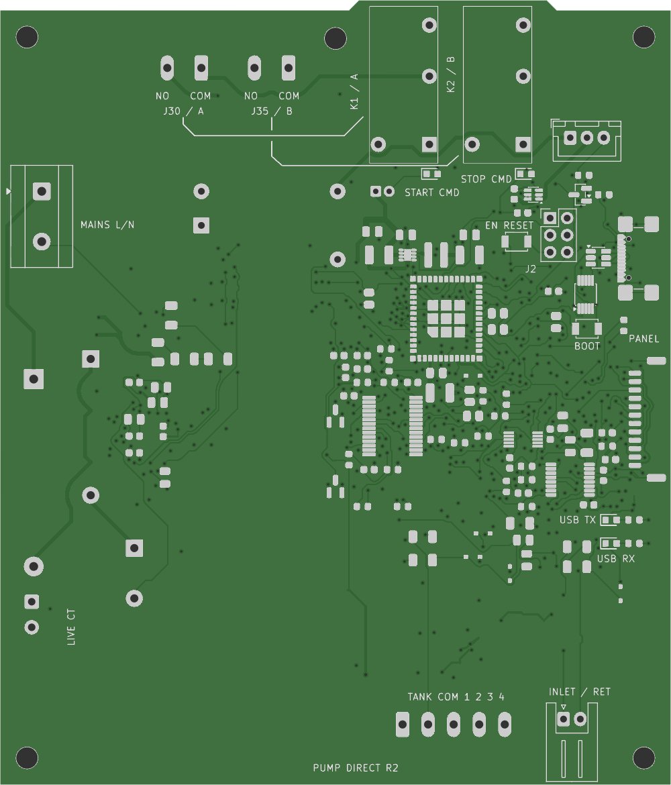

# Pump starter controller

A two-board prototype for an existing 1 HP single-phase pump starter. The main board measures supply voltage, reads a current transformer and tank probes, and issues starter commands through two replaceable relays. The door panel has a plug-in OLED, five operator buttons, an optional key selector and an external button connector. The existing starter switches the motor and capacitors.

| What you need | Files |
| --- | --- |
| Edit the main circuit or board | [Main KiCad project](hardware/main/pump-direct.kicad_pro) · [Schematic PDF](docs/main-schematic.pdf) · [Board drawing](docs/main-board.svg) |
| Edit the door panel | [Panel KiCad project](hardware/panel/pump-panel-rev-f.kicad_pro) · [Schematic PDF](docs/panel-schematic.pdf) · [Panel with display, STEP](mechanical/panel/pump-panel-rev-f-with-display.step) |
| Identify a terminal or relay | [Starter interfaces and connectors](docs/connections.md) |
| Program or recover the processor | [USB bench guide](docs/programming.md) · [Bench firmware](firmware/bench) |
| Request bare boards and assembly | [Manufacturing package and cost](manufacturing/README.md) |
| Reproduce the design checks | [Verification](verification/README.md) |

## Hardware

The main PCB is 100 × 117 mm with six copper layers. Printed guides identify K1 with J30 (A) and K2 with J35 (B). The two pilot outputs can serve a conventional self-holding DOL or a starter with documented remote inputs. Select the control profile for the specific starter. The 60 × 45 mm two-layer panel connects to main J32 through a keyed 12-way cable.

The main board uses an ESP32-C6-MINI-1U-H8. The two dedicated programming buttons and USB application indicators are on its low-voltage side. Operator START, STOP, MODE, SET and NEXT are on the panel. The repository includes a flashable USB bench image, control components and tests. Operational wireless firmware, pairing with a particular hub, enclosure fit and physical starter qualification remain open.

The design is at prototype stage. The original DOL STOP and overload must independently interrupt the contactor coil. A welded pickup contact can restart some starters when STOP is released. Review that behavior and the actual coil specification before commissioning. [Interface details](docs/connections.md)
