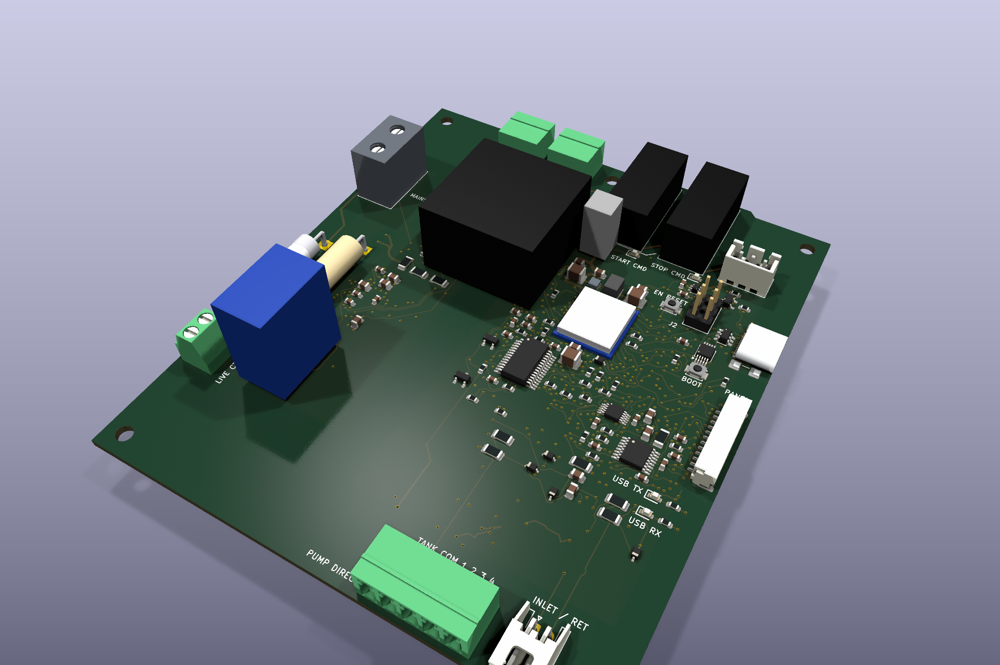
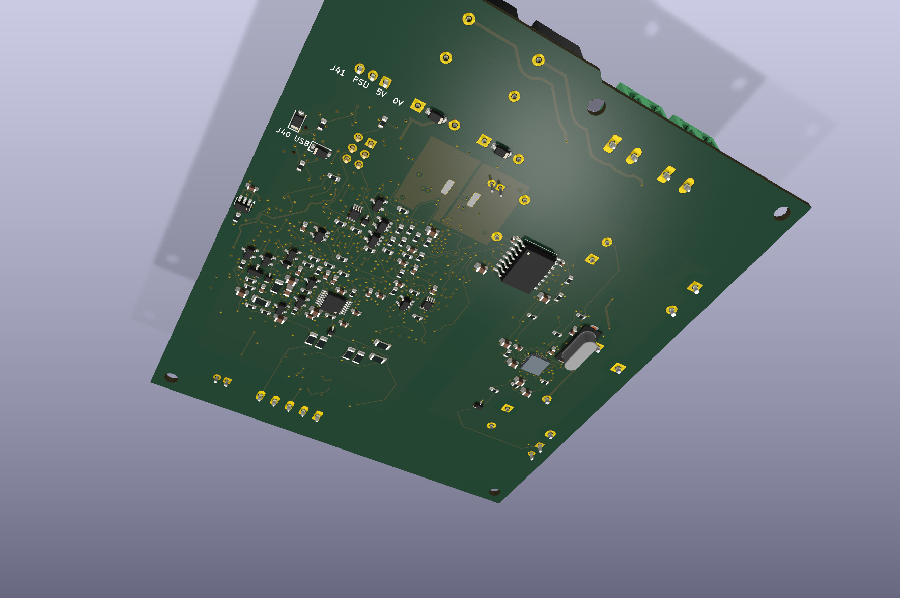
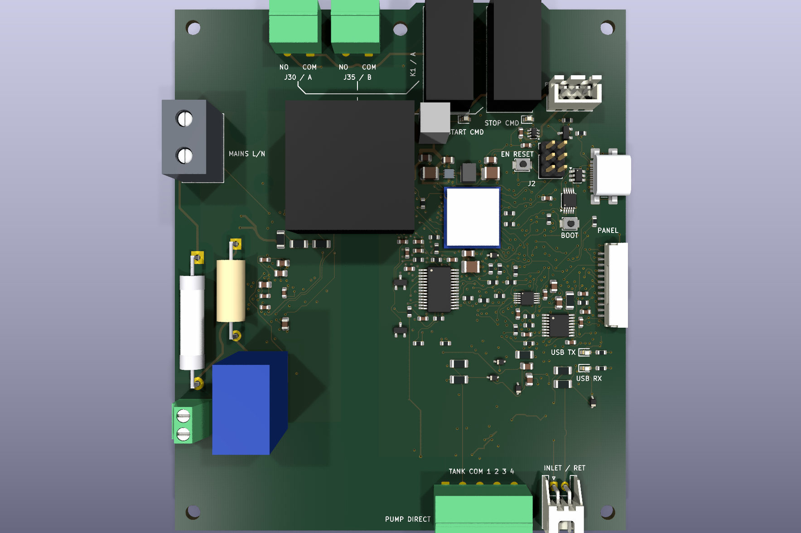
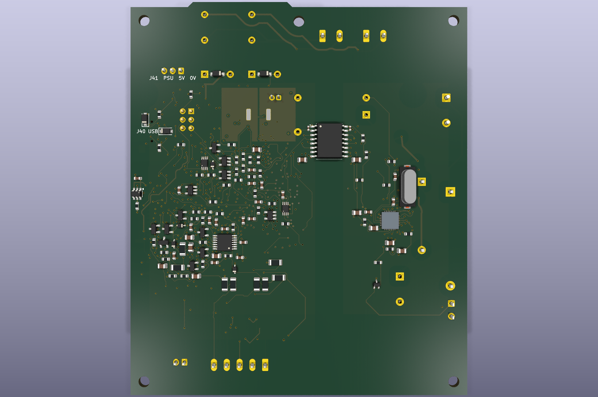
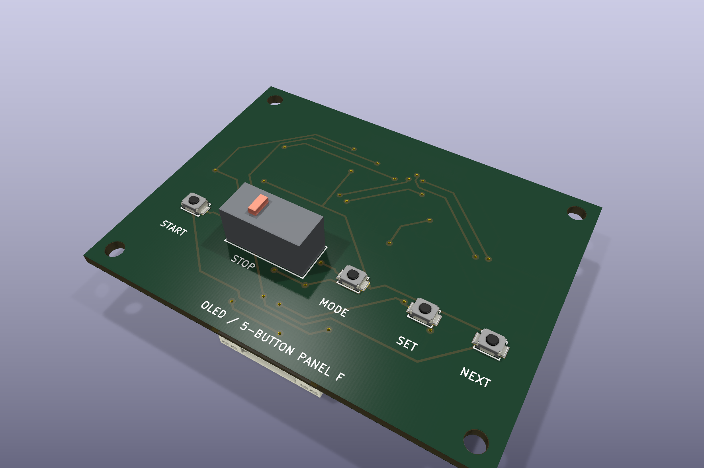
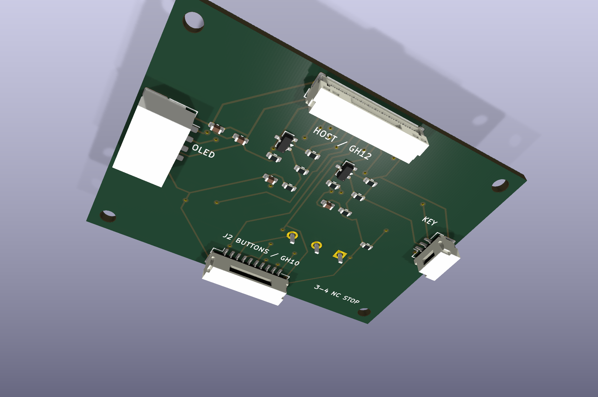

# 3D views

Rendered from the released KiCad layouts with `kicad-cli pcb render`. GitHub shows the STL files in an interactive viewer: open [main.stl](main.stl) or [panel.stl](panel.stl) and drag to rotate. The GLB files ([main.glb](main.glb), [panel.glb](panel.glb)) keep the part colours and open in any glTF viewer, Blender or Windows 3D Viewer.

U1, U3, K1, K2, R1, F1 and RV1 use simplified body models sized from their datasheets (`hardware/main/models/*-envelope.wrl`). They show position and height only and are not mechanical references. The other parts use KiCad library models or the project's STEP models.

## Main board R2, 100 × 117 mm

| Top | Bottom |
| --- | --- |
|  |  |
|  |  |

## OLED panel F, 60 × 45 mm

| Front | Rear |
| --- | --- |
|  |  |

## Regenerating

```sh
kicad-cli pcb render --quality high --perspective --rotate '-40,0,-30' --zoom 0.9 -o docs/3d/main-top-iso.png hardware/main/pump-direct.kicad_pcb
kicad-cli pcb export stl -o docs/3d/main.stl hardware/main/pump-direct.kicad_pcb
kicad-cli pcb export glb -o docs/3d/main.glb hardware/main/pump-direct.kicad_pcb
```
