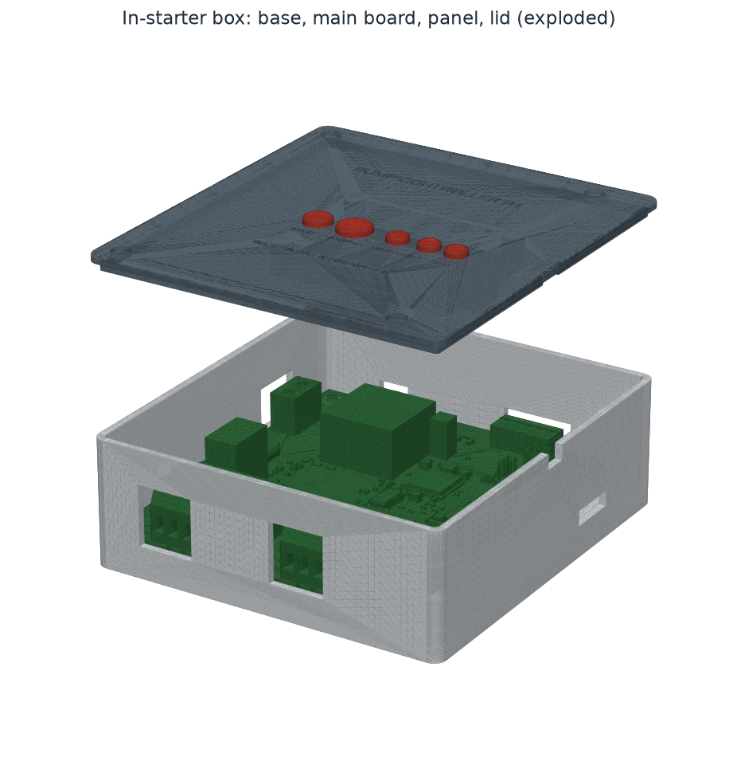
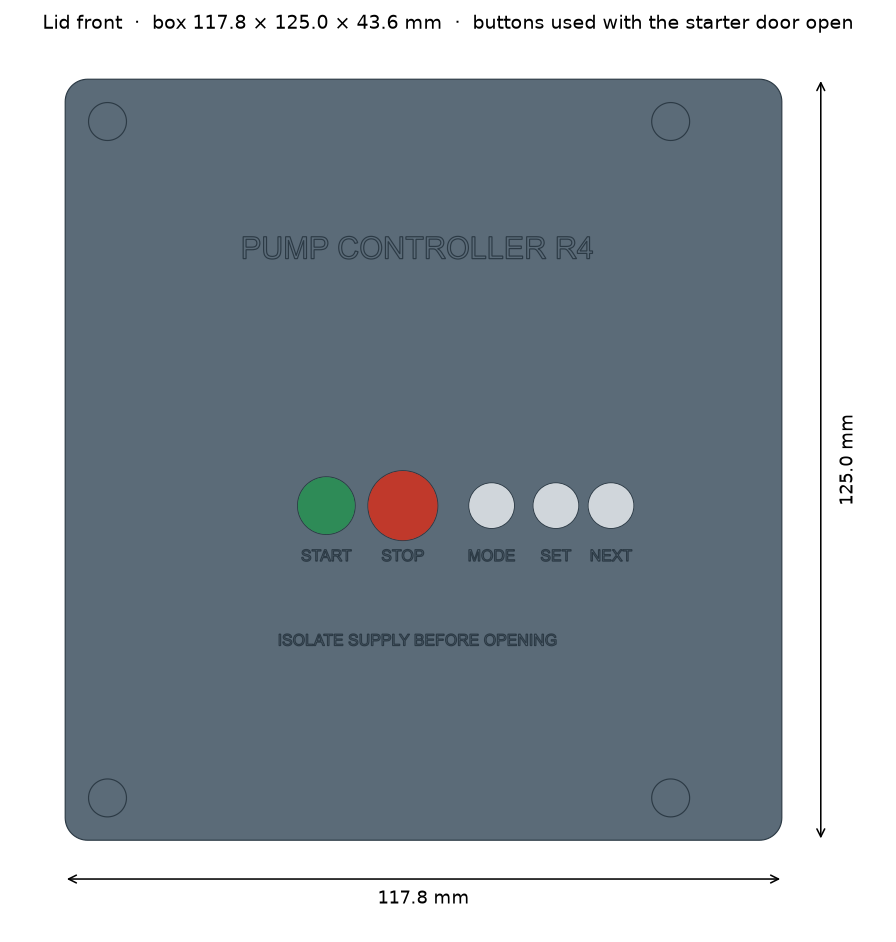
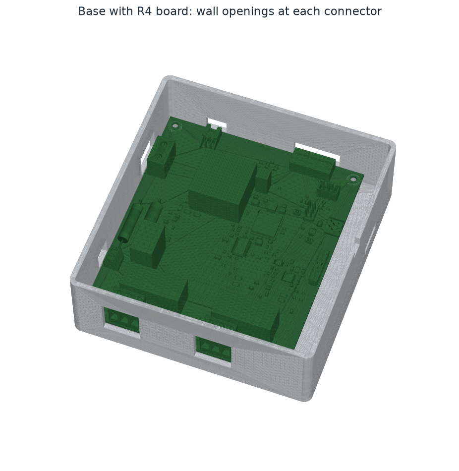
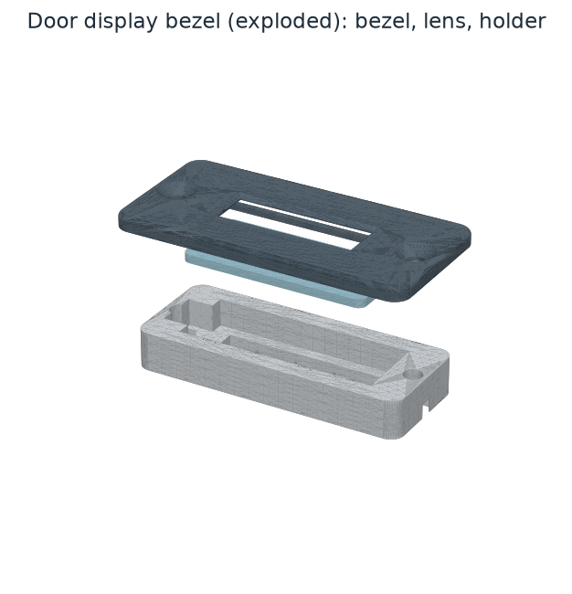

# In-starter enclosure for the R4 controller

A compact printed box that sits **inside the starter cabinet**. It holds the R4 main board, with the button panel under its lid. The OLED moves to a small bezel in the **starter door**: the display is visible with the door closed, and the buttons are used with the door open.



| | |
| --- | --- |
| Box outside | **117.8 × 125.0 × 43.6 mm** |
| Main board | R4, 100 × 118.5 mm, on four M3 bosses |
| Panel F | Under the lid on four bosses; the panel is 8.5 mm below the lid's inner face |
| Panel to main board | **3.2 mm** minimum, over the U1 power module; about 15 mm over most of the board |
| Lid to tallest part | 8.0 mm, over RV1 |
| Door cut-out | 31 × 12 mm rectangle plus two Ø3.4 mm holes at 45 mm centres ([1:1 template](out/door-cutout-template.pdf)) |



## Parts to print

| File | Part | Material |
| --- | --- | --- |
| `out/base.stl` / `.step` | Box base | PETG or ASA. A flame-retardant grade (PC-FR, ABS-FR) is better inside a mains cabinet. 4 perimeters. |
| `out/lid.stl` | Lid with button holes and labels | Same as the base. Print face down. |
| `out/button_caps.stl` | 5 button caps | PETG. Print stems up. Print STOP in red and START in green if you can. |
| `out/door_bezel.stl` | Display bezel, outside the door | PETG or ASA |
| `out/door_holder.stl` | Display holder, inside the door | PETG |
| `out/door_lens.stl` | Display window | Cut from 1.5 mm clear acrylic or polycarbonate to this outline |

## Hardware

| Qty | Item | Use |
| ---: | --- | --- |
| 4 | M3 heat-set insert, Ø4 × 5 mm | Base bosses |
| 4 | **M3 male-female hex spacer, 30 mm** | Clamp the main board; the lid screws into them |
| 4 | M3 × 6 pan-head screw | Lid to spacers |
| 4 | M2.5 heat-set insert, Ø3.5 × 4 mm | Lid panel bosses |
| 4 | M2.5 × 5 screw | Panel F to the lid |
| 2 | M4 countersunk screw | Box to the starter back plate, fitted before the board |
| 2 | M3 × 12 countersunk screw + M3 nut | Door bezel, through the door into the holder |
| 1 | **JST PH 4-way lead, 300–500 mm, wired 1→1** | Panel J7 to the OLED in the door, replacing the 100 mm lead |

## How it fits together

1. Press the M3 inserts into the base bosses and the M2.5 inserts into the lid bosses.
2. Screw the empty base to the starter back plate with the two M4 countersunk screws. The heads sit flush under the board.
3. Drop the main board in and fit the four 30 mm hex spacers through its corner holes into the base.
4. Mount panel F on the lid bosses with the five caps in their holes. Each cap's flange keeps it from falling out, and the panel holds it in place.
5. Cut the door using the template. Fit the bezel and lens outside, the OLED module in the holder inside, and clamp them through the door with two M3 screws.
6. Plug the 12-way loom from main J32 into panel J1, and the STOP loop plug into panel J2. Run the long PH lead from panel J7 out through the slot at the top of the right wall to the door OLED.
7. Close the lid with four M3 × 6 screws.

## Wall openings

Each field connector is reached through a window in the wall, sized to the connector:

| Wall | Connector | Use |
| --- | --- | --- |
| Left | J1 | AC supply L / N |
| Left | J10 | CT |
| Top | J21 | Inlet probe plug |
| Top | J20 | Tank probe plug |
| Bottom | J30 | Starter output A: NO, COM, NC |
| Bottom | J35 | Starter output B: NO, COM, NC |
| Right | J40 | USB-C programming, without opening the box |
| Right, under the lid | Slot | Display lead to the door |

The J30/J35 and J1/J10 screws are on top of the terminal blocks, so tighten them with the lid off.





## Rebuilding

```bash
.venv/bin/python mechanical/enclosure-r4/build.py
.venv/bin/python mechanical/enclosure-r4/render.py
```

`build.py` reads the board outline, connector positions and part heights from the R4 3D export (`docs/3d/main.glb`). It picks the shortest standard spacer that gives at least 3 mm between the panel, including its rear plugs, and every main-board part. `out/manifest.json` records the resulting dimensions and clearances. All the main-board and panel 3D parts were checked against the base, lid and caps with no intersections.

## Not yet checked

- **Fit in the actual starter.** Measure the free space inside the cabinet, the back-plate mounting, and the door thickness. The bezel's locating spigot assumes a door at least 1 mm thick.
- **Display lead length.** I2C over a 300–500 mm lead normally works at 100 kHz. Test the OLED on the real lead before closing up.
- **Not sealed.** The box relies on the starter cabinet for dust and water protection. The connector windows expose the screw terminals, so treat the box as live whenever the starter is energised.
- **Print and fit.** Check the sizes of the button holes, the spacers, the inserts and the terminal windows on the first print.
