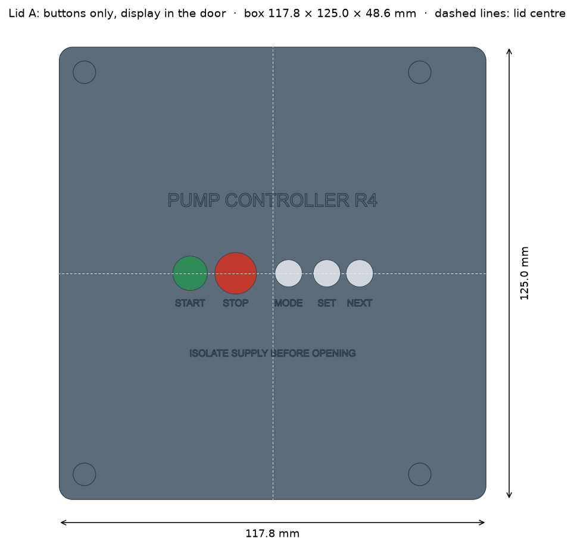
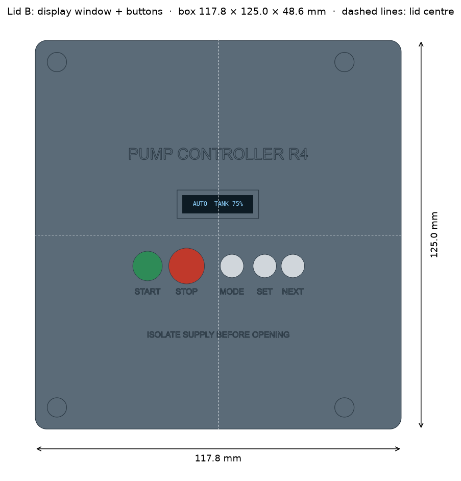
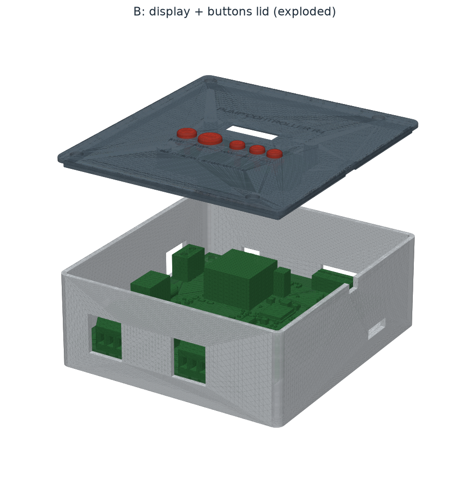

# In-starter enclosure for the R4 controller

A compact printed box that sits **inside the starter cabinet**. The base holds the R4 main board, and panel F hangs under the lid. There are two lids for the same base:

| Version | Lid | Display |
| --- | --- | --- |
| **A, buttons** | Five buttons, centred on the lid | OLED in a small bezel in the **starter door**, visible with the door closed. The buttons are used with the door open. |
| **B, display** | Display window above the five buttons, centred as a group | OLED on panel F behind a clear lens in the lid. No door cut-out. |

| | |
| --- | --- |
| Box outside | **117.8 × 125.0 × 48.6 mm** (both versions) |
| Main board | R4, 100 × 118.5 mm, clamped by four 35 mm M3 spacers that also carry the lid |
| Panel F | 8.5 mm below the lid's inner face, on four bosses |
| Panel PCB to main-board parts | **8.2 mm** minimum |
| Panel rear plugs to main-board parts | **3.9 mm** minimum |
| Lid to tallest part (RV1) | 13.0 mm |
| Door cut-out (version A) | 31 × 12 mm plus two Ø3.4 mm holes at 45 mm centres ([1:1 template](out/door-cutout-template.pdf)) |

| Version A | Version B |
| --- | --- |
|  |  |

The **button spacing is uneven** (12.5, 14.5, 10.5 and 9 mm) because the lid follows the switch positions on panel F. The large STOP switch sets most of that spacing. Even spacing needs the switches moved on the panel PCB, in revision G.

## Parts to print

| File | Version | Part | Material |
| --- | --- | --- | --- |
| `out/base.stl` | A and B | Box base | PETG or ASA. A flame-retardant grade (PC-FR, ABS-FR) is better inside a mains cabinet. 4 perimeters. |
| `out/lid_buttons.stl` | A | Lid with button holes | Same as the base. Print face down. |
| `out/cap_START.stl` … `out/cap_NEXT.stl` | A and B | 5 button caps, one file each; the same caps fit both lids | PETG or resin. Print stems up. |
| `out/door_bezel.stl` | A | Display bezel, outside the door | PETG or ASA |
| `out/door_holder.stl` | A | Display holder, inside the door | PETG |
| `out/door_lens.stl` | A | Door window | 1.5 mm clear acrylic or polycarbonate |
| `out/lid_display.stl` | B | Lid with display window and button holes | Same as the base. Print face down. |
| `out/lid_lens.stl` | B | Lid window, glued into the pocket inside the lid | 1.5 mm clear acrylic or polycarbonate |

STEP files with the same names are in `out/`. `button_caps_buttons` and `button_caps_display` hold all five caps in their assembled positions, for checking fit only; print the single-cap files.

**JLC 3D printing quote (2026-11-25, one box, white 9600 resin):** base $8.33, lid A $3.52 or lid B $3.43, door holder $0.34. The door bezel and caps add about $1.80. Shipping to India by UPS is about $9.50 plus import duty. For comparison, the base alone costs $10.71 in PLA-P, $22.37 in black resin, $26.17 in ABS, $33.31 in ASA, $34.50 in MJF PA12 nylon and $40.45 in PC-ABS.

## Hardware

| Qty | Item | Use |
| ---: | --- | --- |
| — | M3 hand tap | Tap the four 2.5 mm base boss holes; no metal insert under the live board |
| 4 | **Nylon M3 male-female hex standoff, 35 mm** (JLCMC ECSD-P-M3-L35) | Clamp the main board; the lid screws into them |
| 4 | Nylon M3 × 6 pan-head screw (JLCMC ECSE-P-M3-L6) | Lid to standoffs |
| 4 | M2.5 heat-set insert, Ø3.5 × 4 mm | Lid panel bosses |
| 4 | M2.5 × 5 screw | Panel F to the lid |
| 2 | M4 countersunk screw | Box to the starter back plate, fitted before the board |
| 2 | M3 × 12 countersunk screw + M3 nut | Version A door bezel |
| 1 | JST PH 4-way lead, 300–500 mm, wired 1→1 | Version A: panel J7 to the OLED in the door |

## How it fits together

1. Tap the four base boss holes M3. Press the M2.5 heat-set inserts into the lid bosses.
2. Screw the empty base to the starter back plate with the two M4 countersunk screws. The heads sit flush under the board.
3. Drop the main board in and fit the four 35 mm nylon hex standoffs through its corner holes into the base.
4. Mount panel F on the lid bosses with the five caps in their holes. Each cap's flange keeps it from falling out, and the panel holds it in place.
   - Version B: glue the lens into the pocket inside the lid first. Fix the OLED module to the front of panel F so its glass lines up behind the window.
5. Version A only: cut the door using the template. Fit the bezel and lens outside and the OLED in the holder inside, clamped through the door with two M3 screws. Run the long PH lead from panel J7 through the slot at the top of the right wall.
6. Plug the 12-way loom from main J32 into panel J1, and the STOP loop plug into panel J2.
7. Close the lid with four M3 × 6 screws.

## Wall openings

Each field connector is reached through a window in the wall, sized to the connector:

| Wall | Connector | Use |
| --- | --- | --- |
| Left | J1 | AC supply L / N |
| Left | J10 | CT |
| Top | J21 | Inlet probe plug |
| Top | J20 | Tank probe plug |
| Bottom | J30 | Starter output A: NO, COM, NC |
| Bottom | J35 | Starter output B: NO, COM, NC |
| Right | J40 | USB-C programming, without opening the box |
| Right, under the lid | Slot | Version A display lead |

The J30/J35 and J1/J10 screws are on top of the terminal blocks, so tighten them with the lid off.



## Rebuilding

```bash
.venv/bin/python mechanical/enclosure-r4/build.py
.venv/bin/python mechanical/enclosure-r4/render.py
cd mechanical/enclosure-r4 && ../../.venv/bin/python export_viewer.py
```

`build.py` reads the board outline, connector positions and part heights from the R4 3D export (`docs/3d/main.glb`). It picks the shortest standard spacer that gives at least 3 mm between panel F, including its rear plugs, and every main-board part in both versions. `out/manifest.json` records the dimensions and clearances. All the main-board and panel 3D parts were checked against the base, both lids and both sets of caps with no intersections.

## Not yet checked

- **Fit in the actual starter.** Measure the free space inside the cabinet, the back-plate mounting, and the door thickness for version A.
- **Version A display lead.** I2C over 300–500 mm normally works at 100 kHz. Test it before closing up.
- **Not sealed.** The box relies on the starter cabinet for protection. The connector windows expose the screw terminals, so treat the box as live whenever the starter is energised.
- **Print and fit.** Check the sizes of the button holes, the spacers, the inserts and the terminal windows on the first print.
